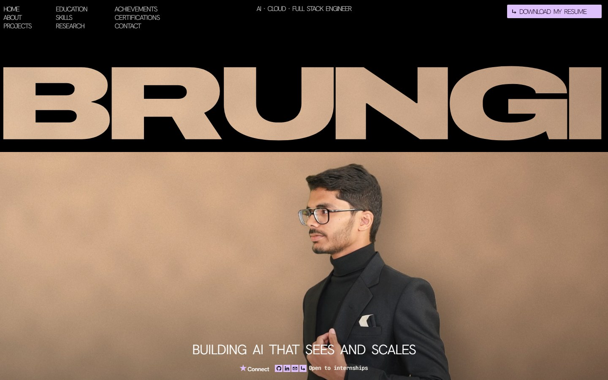
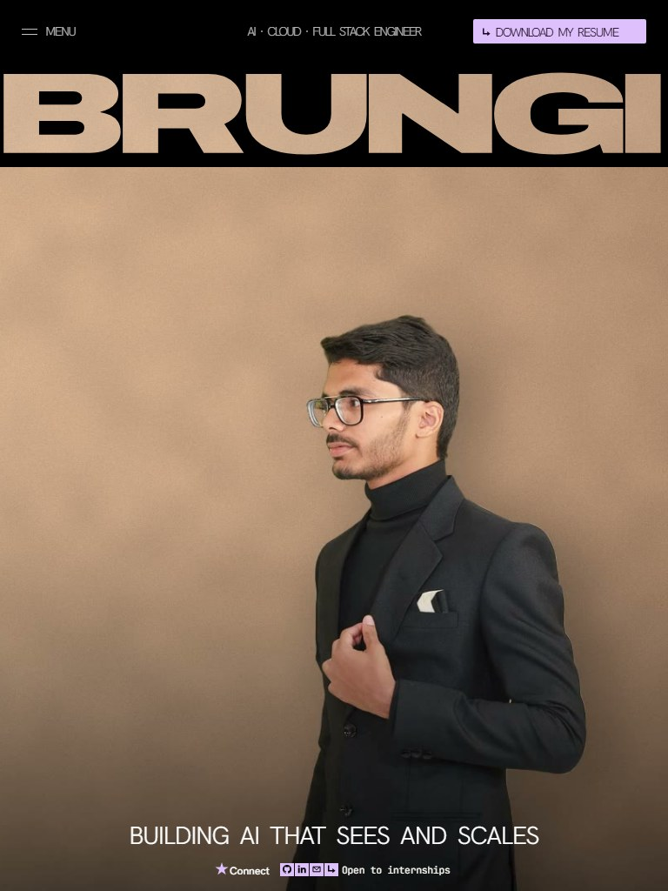
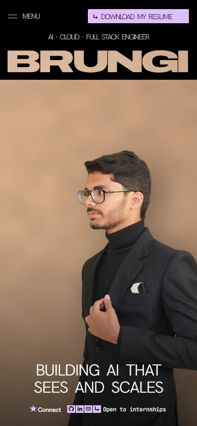
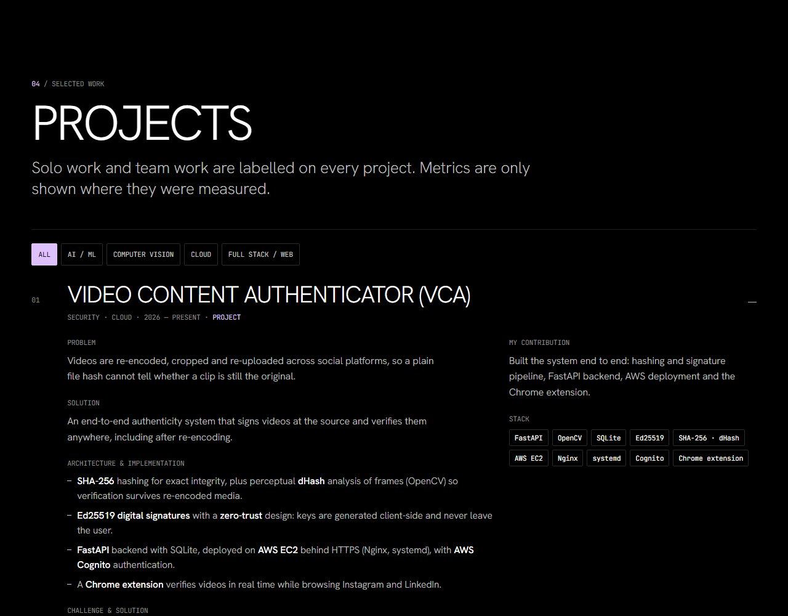
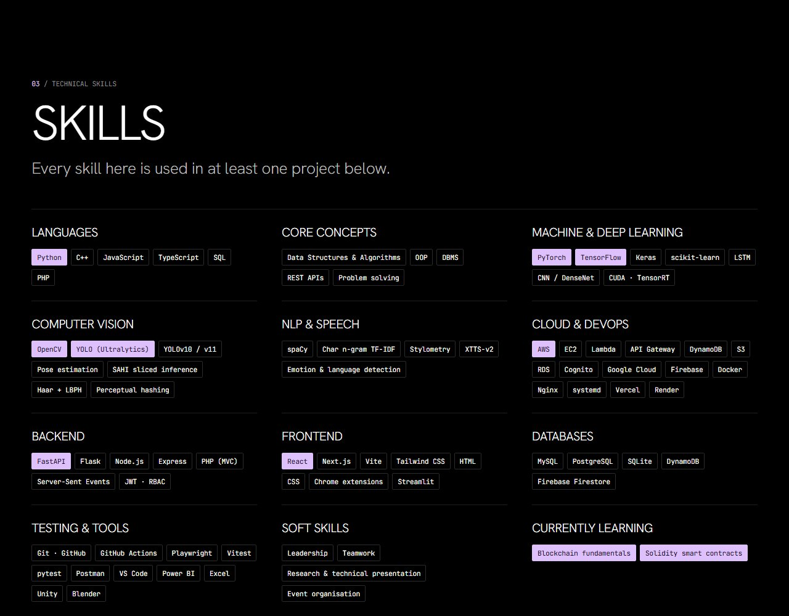
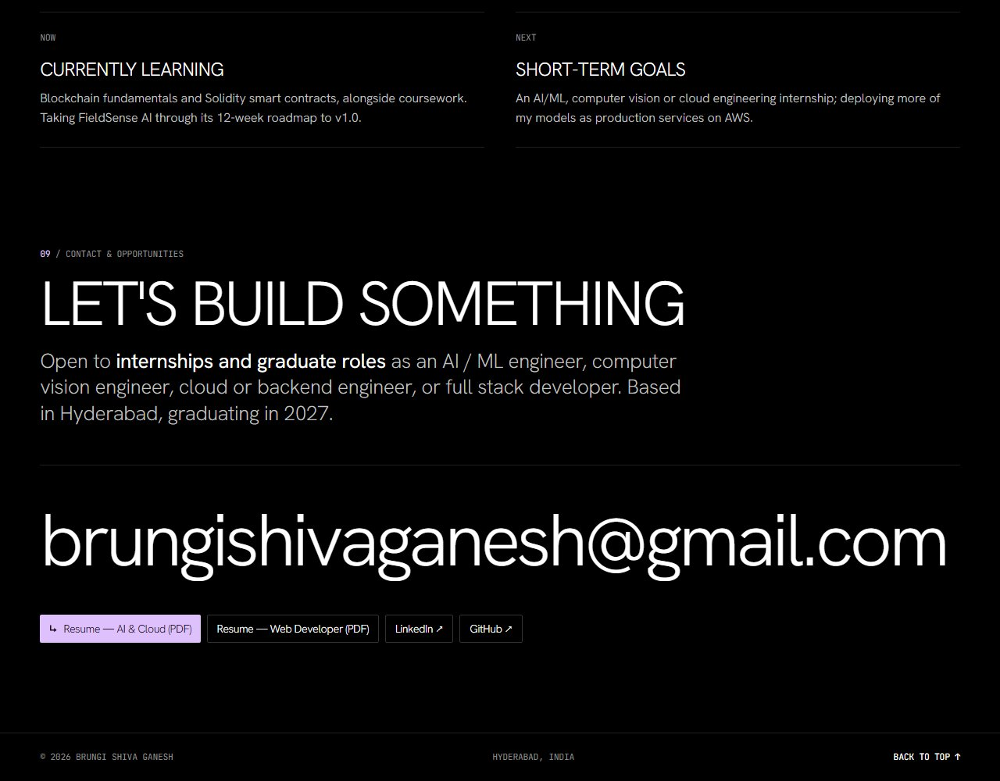
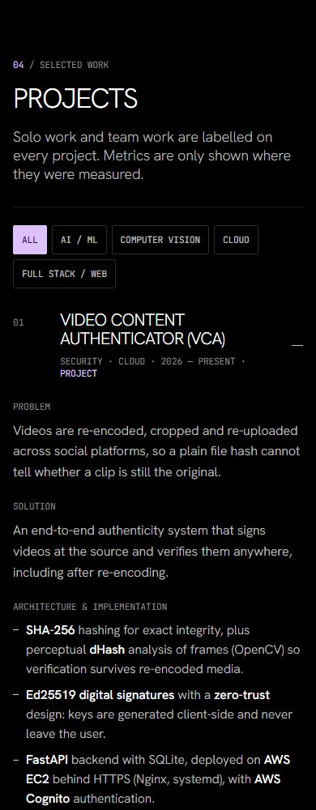

# Brungi Shiva Ganesh — Portfolio

Personal portfolio of **Brungi Shiva Ganesh**, B.Tech Computer Science & Engineering (Data Science) at NMIMS (STME), Hyderabad, class of 2027. It covers AI/ML, computer vision, cloud and full stack work.

**Live:** https://shivv-14.github.io/brungi_portfolio/

## Screenshots

| Desktop | Tablet | Mobile |
|---|---|---|
|  |  |  |

| Projects | Skills | Contact |
|---|---|---|
|  |  |  |



## What's on the page

1. **Hero.** A full-viewport black band with the BRUNGI wordmark knocked out of it, so the background video shows through the letters. Below it are the nav, a lilac resume CTA, the headline and a Connect row (GitHub, LinkedIn, email, contact).
2. **About.** Introduction, career objective, specialisation, interests, approach to problem solving and key numbers.
3. **Education.** NMIMS, Sri Guru Junior College and Chaitanya Central School.
4. **Skills.** Grouped by area. Every skill listed is used in a project.
5. **Projects.** 16 expandable case studies with problem, solution, architecture, data, results, my contribution, stack and links. Filters: AI/ML, computer vision, cloud, full stack.
6. **Research.** The IICTDS 2025 paper and the stylometry study.
7. **Achievements, certifications, GitHub, current learning and goals.**
8. **Contact.** Email, LinkedIn, GitHub and both resumes as PDF downloads.

## Build notes

- Single static `index.html` with inline CSS and JS. No framework and no build step.
- The hero layout is written in reference pixels of a 1280-wide canvas (`--u`). It has three layouts: desktop, tablet (below 1075 px wide or 538 px tall) and mobile (below 560 px).
- The background video is a 10 s seamless H.264 loop. It was made from a photo with the background removed (BiRefNet), composited onto a warm studio wall and given a slow push-in.
- The wordmark is an even-odd SVG path made from Archivo (width 125, weight 900). Each letter has a "lid" that lifts during the entrance animation.
- The entrance animation uses the Web Animations API and runs once. Sections fade in on scroll. Both are turned off under `prefers-reduced-motion`.
- Self-hosted fonts: Hanken Grotesk and JetBrains Mono (variable woff2).

## Run locally

```bash
python -m http.server 8000
# open http://localhost:8000
```

Deployed with GitHub Pages from the `main` branch root.
